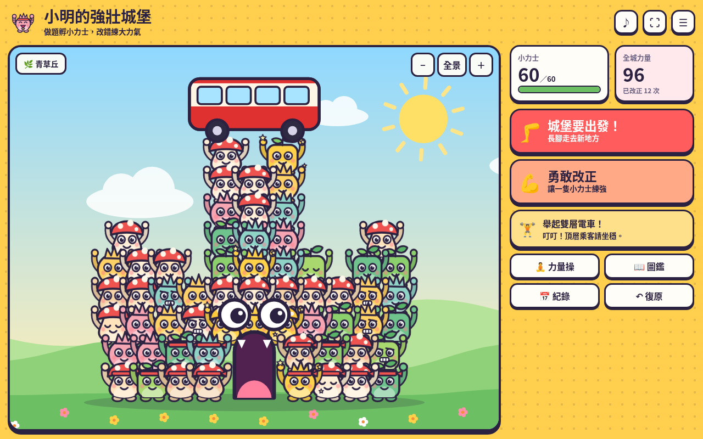

# 強壯城堡 Strong Castle

做題孵小力士，改錯練大力氣。

這座城堡沒有一塊積木，由一隻隻活生生的小力士互相托舉而成。城堡會呼吸、會望住你、門口是一張大嘴，完成目標後還會長出雙腳，走到新地方。

公開網站：https://porscheyeung.github.io/Strong-Castle/

這是 [勇氣城堡 Courage Castle](https://github.com/porscheyeung/Courage-Castle) 的全新獨立版本。舊城堡的程式、網址及存檔都沒有改動。



## 玩法

| 動作 | 結果 |
| --- | --- |
| 完成一題 | 蛋從天而降，孵出一隻小力士，站到城堡的位置上（1 點力量） |
| 勇敢改正 | 小力士練出肌肉並升級，最高第 5 級（3 點力量）；先點選可指定練哪一隻，否則練最弱的一隻 |
| 舉重挑戰 | 力量足夠時連按或喊「加油」，舉起菠蘿包、小巴、電車、大象、藍鯨，最後到月亮；舉起的東西會放在城堡頂 |
| 完成目標 | 城堡長出雙腳走到新地方，孵出當地品種，目標隻數增加 |
| 力量操 | 32 秒四個動作的小休息，全城力士一起做 |

其他功能：

- 五個地方、15 個品種的圖鑑，約十六分之一機會孵出閃閃金毛
- 點按小力士查看資料及改名
- 依裝置時鐘轉換日夜，夜晚閒置時全城入睡
- 今日、連續天數、最近七天紀錄、舉重榜、城堡相簿
- 紀念海報、備份匯出及匯入
- 在同一瀏覽器找到勇氣城堡存檔時，可把舊積木喚醒成小力士（只讀取，不改動舊存檔）

## 技術

純 HTML、CSS、JavaScript，無外部字型、圖片或執行期套件。所有美術用 Canvas 程式繪畫。

- `engine.js`：資料、規則、城堡排列、存檔驗證，不依賴瀏覽器
- `art.js`：小力士、地方、舉重物品的繪畫
- `app.js`：動畫、操作及對話框

資料只存在瀏覽器（`strong-castle-save-v1`），沒有帳戶或伺服器。喊聲功能只量度音量，不錄音、不上傳，並須使用者主動開啟。

## 測試

```bash
npm ci
npx playwright install chromium
npm test
```

結果見 [docs/TEST-RESULTS.md](docs/TEST-RESULTS.md)。
